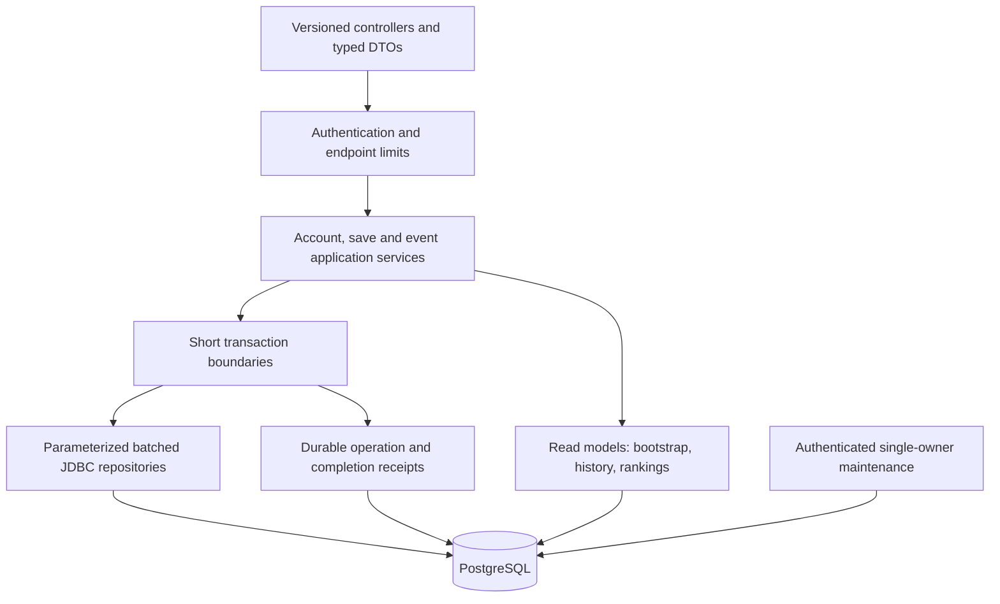

# Arrow Binge backend — complete system architecture

Updated October 21, 2026. Current service map first; proposed progress/event redesign follows as a subsystem specification.

## Current deployment and request path

Android CloudApi → HTTP service → SecurityConfiguration custom filter / BoundedRequest → controllers → transactional Java services → JdbcTemplate → PostgreSQL. Spring Boot 4.1.1 with Java 17, Spring MVC, Security, validation, JDBC, Flyway and Actuator is declared in pom.xml. DatabaseEnvironmentPostProcessor and DatabaseUrlParser normalize connection configuration. GoogleIdentity is the external identity boundary; Crypto supports credential/token processing.

The service is a single deployable application, not microservices. Docker builds with Maven and runs a non-root Java 17 image. Its current build skips tests and runtime uses SerialGC with 75% max RAM allocation; those are configuration facts, not measured optimal settings. Testing must occur before image promotion, and native/thread/pool headroom must be measured.

## Module ownership

| Module | Responsibility |
|---|---|
| ApiController | v1 auth, profile/session, save/reset, export and deletion routing |
| AuthService / GoogleIdentity / Crypto | Challenge verification, Google identity, session issuance/rotation/revocation, principal and recent-auth checks |
| SaveService | Snapshot validation/merge, epochs, attempts, imports and retry records; updates regular leaderboard within save/reset consistency boundary |
| LeaderboardController / LeaderboardService | Opt-in regular rankings, nickname validation, top-50 and exact own-position reads |
| EventController / EventService | Daily/tournament tickets, enrollment, completion credit, mine/history and standings |
| EventSchedule | UTC day/week keys and deterministic daily/50-board weekly rotation |
| Catalog | Packaged content metadata and completion validation; must match supported Android content |
| SecurityConfiguration / BoundedRequest | Authentication/route classification, rate limiting and body resource boundaries |
| ExpiredDataCleanup | Expired session/challenge/event/rate data maintenance; access and multi-instance ownership need explicit checks |
| RootController / application bootstrap | Root/operational responses and runtime configuration; deployment probes require environment validation |

## Existing database domains

| Migration | Tables and role |
|---|---|
| V1 accounts/saves | users, auth_challenges, device_sessions; level_progress, level_unlocks, level_attempts, user_preferences; sync_operations, migration_imports; request_limits |
| V1 reward-related schema | hint_wallets, device_hint_allocations, hint_events, reward_intents, reward_receipts; do not infer live API support from schema |
| V2 regular rankings | leaderboard_profiles and score-order index; scores derive from progress |
| V3 events | event_runs, daily_completions, tournament_players, tournament_completions and user/score indexes |

Use new additive migrations for changes. Preserve existing foreign-key/unique constraints and epoch/idempotency behavior. Save/reset/enrollment must use compatible user-lock ordering. Event credit and completion uniqueness belong in the same transaction. External Google I/O must be moved outside long-held database transactions with revalidation when entering the transaction.

## Read models and performance

Regular leaderboard reads top 50 through the ordered index, plus exact own rank and participant count. These are different query costs; a cheap top-50 query does not prove low-ranked own-position lookup is cheap. Event standings/history and active attempts need bounded result sets and explicit pagination where appropriate. Avoid loading every historical record into one JSON response.

Current JDBC service classes combine orchestration and SQL. Evolve via typed request/response objects, explicit transaction entry points and focused repository methods; a new ORM or microservice split is not required. Batch changed rows, preserve deterministic lock order and benchmark candidate indexes with representative cardinality. Public reads should not seed artificial competitors; removal policy must distinguish synthetic rows from genuine users.

## Trust and lifecycle

Runtime secrets/configuration are deployment-owned, never committed defaults or document examples. The custom security filter is part of the authorization boundary even though the framework chain permits requests onward. Validate all routes against actual filter behavior rather than reading permitAll in isolation. Configure trusted-proxy semantics, pool/statement/request deadlines, health exposure, backup retention and protected cleanup before multi-instance deployment.

See [design](design.md) for current endpoint families and the proposed v2 protocol, and [Android architecture](../arrow-binge/docs/ARCHITECTURE.md) for client ownership.

## Detailed progress and event reliability workstream

Retained subsystem specification. Proposed v2 behavior is not implemented merely by documenting it; historical audit results are not a new test run.

Status: target design, October 21, 2026. Preserve useful transactional invariants; replace flow coupling and ambiguous outcomes.

### Layers

Remain on Spring Boot/JDBC/PostgreSQL. Do not introduce microservices or a new ORM for this change.

### Service boundaries

- **AuthApplicationService:** Google token validation outside long database transactions, followed by short nonce-consumption/user/session transaction. Refresh rotation stays serialized per session with stable retry identity.
- **BootstrapQueryService:** one coherent account epoch/revision snapshot and paginated restore cursors. No tournament seeding, standings ranking, or mutation on read.
- **SaveApplicationService:** validate typed bounds, lock owner, check epoch/idempotency, batch mutations, persist acknowledgement and commit atomically.
- **GuestImportService:** globally unique guest claim plus merge in the same transaction. Retry must recover a previous claim instead of silently creating a fresh identity.
- **EventApplicationService:** owner/run validation, unique scoring, immutable receipt creation and next-ticket prerequisites. Completion does not invoke public schedule initialization.
- **RankingQueryService:** bounded top rows and own rank. Shared caches only for nonprivate data, with explicit freshness; never cache a private response under a public key.
- **MaintenanceService:** authenticated single-owner batches, expiry indexes where measured useful, receipt/tombstone retention policy and metrics.

### Database changes to design and migrate

| Entity/change | Purpose |
|---|---|
| Extend sync_operations | Durable ack fields: owner/epoch/operation/payload hash/local revision/server revision/committed time |
| Event completion receipts | Unique receipt per run, stable response fields, outcome, credit and player total revision |
| Tournament player revision | Monotonic per-player score snapshot ordering; clients reject older totals |
| Event run content version | Validate the same board revision the server issued |
| Preference field/version metadata | Detect stale preference writes independently from safe stars/unlock merge |
| Open-attempt index and run policy | Ordered bounded active restores; safe closure/tombstone handling |
| Restore cursor/snapshot metadata | Bind pages to owner/domain/epoch/revision; detect invalidation rather than mix epochs |

All changes use new Flyway migrations. Do not edit applied V1–V3 migrations. Existing operation/ticket IDs remain valid; v1 adapters preserve old shapes.

### Transactions and lock order

Use owner → event run/player/receipt as the consistent lock order for writes. Save/reset/guest import must share the owner serialization rule. Auth uses a separate session/challenge scope; do not hold progress locks across Google/JWK HTTP requests.

Rank observations for a finish should be computed in one repeatable-read completion transaction, before and after this player's score mutation. Other players can move afterward; record asOf and describe the result as an observation, not a permanent global rank. On serialization conflict, retry the complete transaction a bounded number of times using the same completion identity. Never hold a global tournament lock to animate one player's movement.

Public bean entry points define transaction semantics. Internal calls to annotated methods do not establish a new Spring proxy transaction or change isolation. Explicitly document which read helper participates in a write transaction.

### Response and retention boundaries

Commit receipt and mutation before reporting success. Do not acknowledge if receipt serialization/validation cannot produce the promised contract. Persistent receipts must support replay; expire them only with a protocol-level replay horizon/tombstone rule that still rejects obsolete requests safely.

Cap request bytes, nested collection sizes and page bytes. Keep expired rejected event receipts visible long enough for the player to understand the outcome. Never silently drop unresolved work due to a cache budget. Exports use a coherent snapshot/pagination rather than unrelated unbounded reads.

### Performance constraints

Batch item writes and avoid unchanged row updates. Keep pool size aligned with live-instance count and database capacity; do not compensate for long transactions with unbounded threads/connections. Use a bounded request executor, cancellation/deadline strategy, SQL lock/statement timeouts and conservative container headroom. Record JFR/GC/pool wait before changing collectors.

Protocol details: [design.md](design.md). Implementation dependencies: [TASKS.md](TASKS.md). Evidence from the current code: [audit](docs/performance-flow-audit.md).
